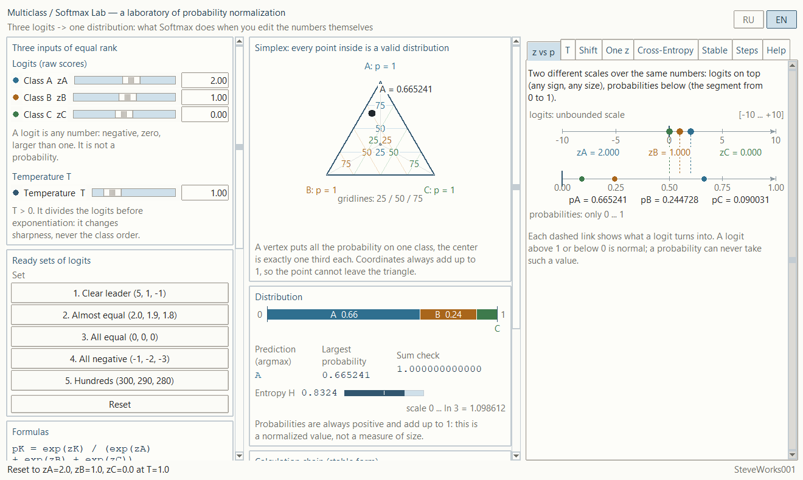
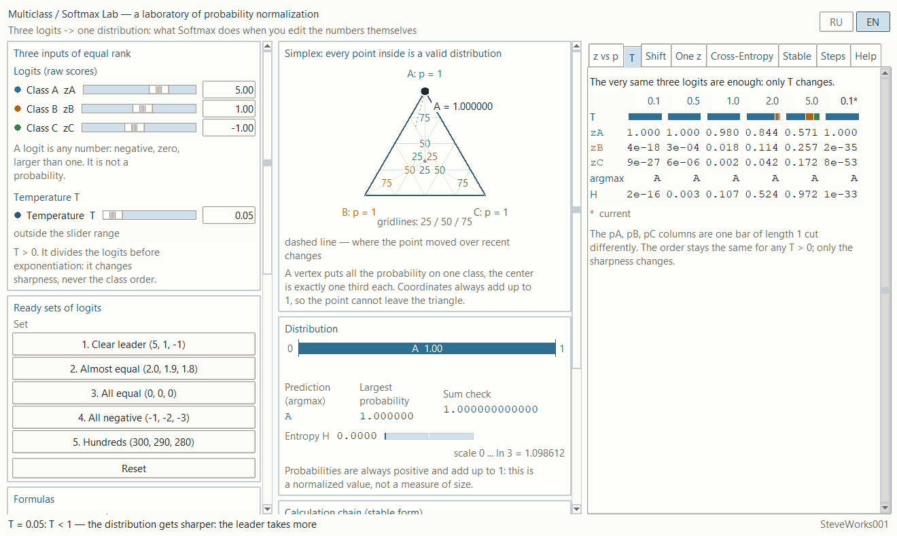
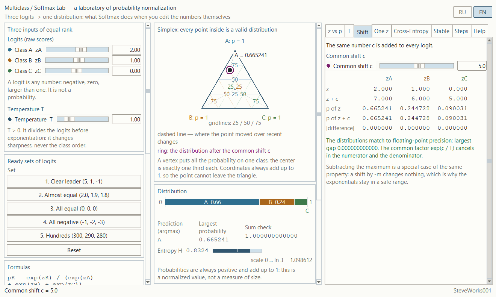
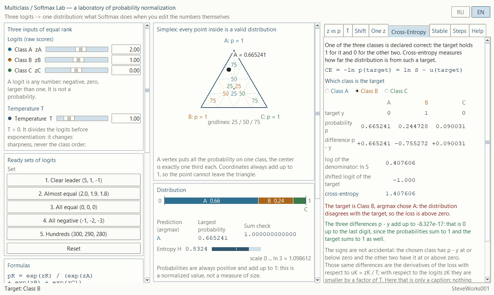
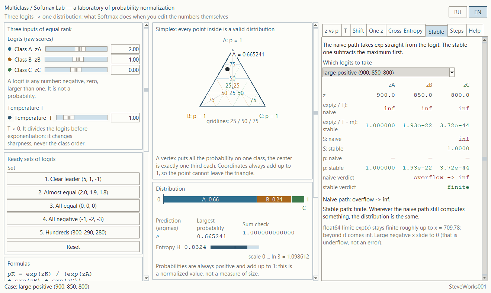

# Multiclass / Softmax Lab — an educational simulator of probability normalization

A single-file Python and Tkinter application: standard library only, no external
packages, no network and no dependency installation.
It demonstrates one chain through a live experiment: **three logits → division by
temperature → subtracting the maximum → exponentials → denominator → three
probabilities → prediction**. This is not a machine-learning library and not a
classifier that learns anything.

[Русская версия README](README_RU.md)

---

## Purpose

The simulator answers one question: **what exactly does Softmax do with the
numbers you put into it**. The input is three logits of equal rank — for class A,
class B and class C. You edit them directly in fields and sliders, with no
weights, no features and no training. The output is three probabilities that are
always positive and always add up to one, plus the prediction, which is the
argmax of that distribution.

The main chain the whole interface is built on:

**z → z / T → m → u = z / T − m → exp(u) → S → p → pred**

The same calculation is shown in four forms at once: a point in the simplex, a
stack bar exactly one unit long, a table of intermediate values, and two scales —
logits and probabilities — over the very same numbers. There are no decorative
lines and no canned conclusions: every number is computed from the current logits
and the current temperature, and the naive and the stable path start from the same
state.

### What this project does not contain

Earlier projects of the series teach classification and training. Neither is here,
on purpose:

- no weights, biases, features or a coefficient matrix: the logits are typed by
  hand and they are the only input;
- no training, no gradients, no epochs and no backpropagation — Softmax appears
  here as a finished normalization function, not as part of a trained model;
  cross-entropy is shown as a number for one chosen target, and nothing is
  recomputed from it;
- no datasets, no labeled examples, no CSV and no data loading;
- no two-dimensional feature plane, no decision boundary and no error map: the
  task has three classes, and the only plane here is the simplex itself;
- no binary classification, no ROC, no accuracy, precision or recall;
- no probability calibration: the application shows the arithmetic and the
  geometry of a normalized distribution and never claims the probabilities match
  real event frequencies;
- no decision thresholds, no cost-sensitive inference and no more than three
  output classes;
- no external libraries: neither NumPy nor SciPy nor matplotlib.

All attention goes to one central fact: Softmax does not measure the size of a
score, it turns three numbers into three shares, and that transformation can be
watched step by step.

## Learning goals

- Understand the difference between a logit and a probability: a logit is any
  number of any sign and any size, a probability is a share on the segment from 0
  to 1.
- Walk through the whole normalization chain and see every intermediate value as
  an actual number.
- Understand why the largest logit always produces the largest probability, and
  why that is the only guarantee about order.
- Understand where the sum of one comes from: a shared denominator divides each
  exponential by the sum of all three.
- See that Softmax is coupled: moving one logit changes all three probabilities at
  once, because the denominator is shared.
- Understand why the maximum is subtracted: an exponential of a non-positive
  number cannot overflow float64, and the distribution does not change because of
  it.
- Compare the naive and the stable path on the same logits and see where the first
  one overflows while the second one still returns an answer.
- Check numerically that adding the same number to every logit changes nothing,
  and meet the residual floating-point difference.
- Understand what temperature does: it divides the logits before exponentiation,
  so it changes sharpness but never the class order.
- See the limit of normalization: low T pushes the distribution onto a single
  class, high T flattens it toward the uniform one, and it never becomes "all
  zeros" or "all ones".
- Learn to read the simplex: a vertex puts all the probability on one class, the
  center is exactly one third each, and the point cannot leave the triangle.
- Understand why a bar one unit long is the same distribution in a different form.
- Get an intuitive feel for entropy as the spread of a distribution, from 0 to
  ln 3.
- Understand what the cross-entropy of one target is: a target with a small
  probability gets a large number, a confident target that matches the
  distribution gets a number close to zero, and it is computed from the
  normalization chain that has already been calculated.
- Understand what a tie in argmax is and why it needs one declared rule.

## Mathematics: three logits and one chain

### The chain

For logits `zA, zB, zC` and temperature `T > 0`:

```
zK / T          scaling by temperature
m  = max(z/T)   the largest scaled logit
uK = zK / T - m the shift that makes the maximum zero
eK = exp(uK)    exponentials: none above 1, none below 0
S  = eA + eB + eC
pK = eK / S     the distribution: the sum is exactly 1
pred = argmax(pA, pB, pC)
```

The "Calculation chain (stable form)" card has eight rows, not seven. Five of
them run per class: `z`, `z / T`, `u = z/T - m`, `exp(u)` and `p`. Three rows are
single scalars shared by the whole table: "maximum m", "denominator S" and `pred`;
each of them holds one value for all three classes, spread across the three
columns. There are still seven steps, because `z / T` and `m` belong to the same,
second step. At `T = 1` the `z / T` column equals the `z` column, and the
interface says so with numbers rather than with words. A row whose step is later
than the current one stays a dash "—" in the dimmed style.

### The stable form

The working path of the application is always the stable one:

```
pK = exp(zK / T - m) / (exp(zA / T - m) + exp(zB / T - m) + exp(zC / T - m))
```

Subtracting the maximum is a special case of the common shift, and a common shift
never changes the distribution. After the shift the exponential is taken of a
number that is not positive, so no overflow is possible for any logits the
application accepts. The denominator is built with `math.fsum` so that values of
very different size do not lose digits.

### The naive path and where it breaks

The "Stable" tab computes the same distribution a second way — straight from
`exp(z / T)`, without subtracting the maximum — and compares the two results row
by row. The boundary is honest: in float64 `exp(x)` stays finite roughly up to
`x = 709.78`, beyond that it is `inf`. The application knows this and does not
crash: the naive path returns a status instead — "finite", "overflow -> inf",
"too small -> 0" or "0 / 0, no result" — and keeps running. The case comes out of
the "Which logits to take" list: "the current logits", "large positive
(900, 850, 800)", "large negative (-900, -950, -1000)" and "mixed (710, 0,
-710)". Choosing a case does not touch the logit fields: the two columns are
computed from their own numbers while everything else in the application stays on
the current logits. When the naive path is not finite, its `p: naive` row shows
dashes instead of probabilities.

### Temperature

```
pK = exp(zK / T) / (exp(zA / T) + exp(zB / T) + exp(zC / T))
```

`T` divides the logits before exponentiation. `T = 1` changes nothing,
`0 < T < 1` amplifies the gap between the logits, `T > 1` smooths it out. For a
positive `T` the class order never changes at any temperature — that is what the
caption under the "Temperature" field and the "T" tab both rest on. Being
strictly positive is a requirement, not advice: at `T = 0` there is no division
to do, and at `T < 0` the class order flips while the numbers still look like a
plausible distribution. The check sits on the field's own commit path: after
typing `0`, `-1` or `-0.5` the entry turns red and keeps its previous
temperature, the status line reports that a temperature strictly above zero is
required, and the numbers on the screen are not recomputed. In the mathematics
the same rule is written out: `z / T` with `T <= 0` raises `ValueError` rather
than `ZeroDivisionError`. The rule adds no upper bound: `T = 0.05` and `T = 200`
are still accepted exactly as before. The "T" tab evaluates the same logits
at `T = 0.1, 0.5, 1.0, 2.0, 5.0` and puts them in five columns side by side; a
sixth column appears only when the current `T` matches none of the five, and it
carries the asterisk — otherwise the asterisk moves above the ready-made column.
Above the numbers in each column is the same bar of length exactly 1, below them
are the argmax and the entropy.

### The common shift

```
Softmax(zA + c, zB + c, zC + c) = Softmax(zA, zB, zC)
```

The "Shift" tab adds the same number `c` to all three logits and shows the two
distributions side by side — the `p of z` and `p of z + c` rows — with a
component-wise difference in `|difference|`. The match is checked by a number
rather than by eye: a gap below `1e-12` counts as agreement up to float64
precision. A residue in the last digits is possible, but it is not obligatory. On
the default logits and on the "1. Clear leader (5, 1, -1)" set at `c = 60` the
difference is exactly zero: `0.000000000000`. On the "2. Almost equal
(2.0, 1.9, 1.8)" set the very same `c = 60` does leave a residue — `5.551e-16` at
`T = 1` and `9.395e-15` at `T = 0.1`.

### One logit

The "One z" tab changes exactly one logit by a value in `[-8 ... +8]`; the class
comes from the "Which logit to move" switch — "Class A", "Class B", "Class C". The
table shows the `p before`, `p after` and `change` columns for every class, and the
three curves under it show how all three probabilities depend on that delta. The
key lesson is visible: when one probability grows, the other two fall, because the
sum is always one.

### Entropy

```
H = -(pA ln pA + pB ln pB + pC ln pC),   0 <= H <= ln 3
```

Entropy is shown as exactly one number and one short bar: `H = 0` means all the
probability sits on a single class, `H = ln 3 ≈ 1.098612` means the distribution is
as flat as it can be. A zero probability contributes 0; the logarithm of zero is
never taken.

### Cross-entropy

A target `y` is a vector of three numbers: 1 for the chosen class and 0 for the
other two. The loss of that target is

```
CE = -ln p(target) = ln S - u(target)
```

The right-hand form is the one the application actually uses: `ln S` and
`u(target)` are taken from the chain before the division, so the number stays
finite even when the class probability is zero in `float64` and the screen
shows `0.000000`. The left-hand form explains the meaning, not the calculation:
taking the logarithm of the displayed probability would mean taking the
logarithm of zero.

The order is the same as the order of probabilities: the smaller `p(target)`
is, the larger `CE` is; the number is never negative, and zero would mean the
target took the whole probability. Like the distribution, `CE` does not change
when a constant is added to every logit: `ln S` and `u(target)` both move by
that constant and cancel in the difference.

The differences `pK - yK` are what remains of the normalization once a target
is compared with it: at or below zero for the chosen class, at or above zero
for the other two, and their sum is zero up to the last digit. Those same
differences are the derivatives of the loss with respect to the scaled logits
`uK = zK / T`, and with respect to the logits `zK` themselves they are those
differences divided by `T`. The application only captions this relation: there
are no gradients, no weight updates and no descent over this number.

### Argmax and ties

The prediction is the index of the largest value. On an exact tie the smaller
index wins, that is the order `A → B → C`; the rule is spelled out in the
interface, and the case itself is marked with an asterisk in the chain table.

## The simplex: the main picture

The primary visualization is an equilateral triangle where vertex A means
`pA = 1`, vertex B means `pB = 1` and vertex C means `pC = 1`. A point inside is a
distribution: its position comes straight from barycentric coordinates, that is,
from the three probabilities themselves. The grid is drawn at 25, 50 and 75 percent
for each class.

Three things follow from this geometry without having to be checked in words:

- the point cannot leave the triangle, because all three probabilities are
  positive and add up to one;
- on the edge opposite a vertex the corresponding probability is zero;
- the center of the triangle is exactly one third for each class, the most spread
  distribution there is.

The current point is drawn as a filled dot, the path over recent changes as a
dashed line: at most the last 18 positions, and only those redraws where the
probabilities actually moved. The ring shows the distribution the current
experiment leads to, and it does not always appear — only on the open "Shift" tab
when `c ≠ 0` and on the open "One z" tab when the delta is not zero. The legend
line under the triangle shows itself in the same moments: "ring: the distribution
after the common shift c" or "ring: the distribution after the delta". On the
other tabs there is no ring. Under the simplex sits the compact stack bar: the
same triple of probabilities cut out of a segment of length exactly 1.

## Ready sets of logits

Five sets, all deterministic:

1. **Clear leader (5, 1, -1)** — a large gap between classes, a confident
   distribution, low entropy.
2. **Almost equal (2.0, 1.9, 1.8)** — logits close together, probabilities close
   together, the prediction resting on tenths.
3. **All equal (0, 0, 0)** — an exact tie: one third each, the `A → B → C` rule
   kicks in, entropy is maximal.
4. **All negative (-1, -2, -3)** — negative logits do not mean negative
   probabilities: the distribution stays normalized.
5. **Hundreds (300, 290, 280)** — the stable path returns exactly the distribution
   it returns for `(10, 0, -10)`: the two sets differ by a common shift of `290`,
   and all three probabilities match exactly, down to zero. The naive path is
   still alive here: the largest exponential is about `1.94e+130` and finite, both
   `p` rows show `0.999955`, `4.54e-05`, `2.06e-09`, and the naive verdict reads
   "finite". The overflow starts later — on "large positive (900, 850, 800)" from
   the case list.

## Interface and how to use it

### Left column

Three logit fields inside the "Logits (raw scores)" card: the slider covers
`-12 ... +12`, but the field accepts any number. Only an absolute value above
`100000` is limited back, and the status line says so. A number inside `100000`
but outside the slider stays in the field, the slider shows its end, and the
caption "outside the slider range" appears under the field — that is not an input
error, logits are routinely in the hundreds. Below sits the "Temperature" field
with a slider of `0.1 ... 5.0` and a value required to be strictly above zero,
then the five ready sets in the "Ready sets of
logits" card, the "Reset" button and the "Formulas" card with six entries:
standard, stable, temperature, common shift, argmax and entropy.

### Center

The simplex with its grid, point, path and ring; underneath, the stack bar and
the three readouts of the "Distribution" card — "Prediction (argmax)", "Largest
probability" and "Sum check", the sum to the twelfth decimal. On an exact tie a
line with the tie rule appears one row below. The next card is entropy with its bar
and the `0 ... ln 3` scale. The last one is "Calculation chain (stable form)":
eight rows under the "Class" heading, five of them per class (`z`, `z / T`,
`u = z/T - m`, `exp(u)`, `p`) and three shared scalars ("maximum m",
"denominator S", `pred`), with the current step highlighted, dashes on unrevealed
rows and an asterisk on a tie.

### Right column: eight tabs

- **"z vs p"** — two scales over the same numbers: logits on top, symmetric and
  unbounded, probabilities below on the segment `0 ... 1`. Dashed links show what
  each logit turned into; there is no horizontal alignment by construction.
- **"T"** — the same logits at five fixed temperatures and at the current one: a
  sixth column is needed only when the current `T` matches none of the fixed
  ones, otherwise the asterisk sits above the ready-made column.
- **"Shift"** — a common shift `c` in `-60 ... +60` and a table with the
  component-wise difference of the two distributions; under it the verdict is
  spelled out as a number, for example "The distributions match to
  floating-point precision: largest gap 0.000000000000".
- **"One z"** — the "Which logit to move" switch, a delta in `-8 ... +8`, a
  `p before` / `p after` / `change` table and three probability curves over the
  delta.
- **"Cross-Entropy"** — a target picked with the "Which class is the target"
  switch, its vector `y`, the current probabilities `p`, the differences
  `p - y` and the cross-entropy of that target as `ln S`, the shifted logit
  of the target and their difference. A
  separate line says whether the target matches argmax. Choosing a target changes
  the target, the differences and the loss, but not the probabilities and not the
  prediction.
- **"Stable"** — nine rows side by side: `z`, `exp(z / T): naive`,
  `exp(z / T - m): stable`, `S: naive`, `S: stable`, `p: naive`, `p: stable`,
  `naive verdict` and `stable verdict`; plus the float64 boundary and the
  "Which logits to take" list.
- **"Steps"** — the seven steps of the chain and a line of chips `logits ->
  maximum -> shifted z-m -> exponentials -> denominator -> probabilities ->
  argmax`: the current chip is highlighted, later ones are dimmed. The buttons are
  Next, Previous and Reset; the left and right arrow keys do the same thing while
  the focus is not inside an entry, a combobox or the tab itself. On the first step
  Previous is inactive; on the last one Next and Reset are, because the initial
  state of the sequence is its last step.
- **"Help"** — sixteen short topics, from "what a logit is" to "what this project
  is not".

### Fields and limits

| Input | Slider range | What the field accepts |
| --- | --- | --- |
| `zA`, `zB`, `zC` | `-12 ... +12` | any number; only `|z| > 100000` is limited back to that bound |
| `T` | `0.1 ... 5.0` | only a number strictly above zero; a positive number outside the slider stays in the field and the slider goes to its end |
| common shift `c` | `-60 ... +60` | the same rule as the logits |
| delta of one logit | `-8 ... +8` | the same rule as the logits |

Non-numeric input does not bring the application down: the field keeps its
previous value and the status line says so. The absolute-value bound is shared by
all four fields, and `T` adds one rule of its own: the temperature has to be
strictly above zero, otherwise the input is refused the same way. Details are in
the "Temperature" section.

### Language

The RU and EN buttons switch the interface at once. The logits, temperature,
shift, delta, chosen target, current tab and current step are not reset — only
the labels change.

## Interface screenshots

The five frames below are real captures of the running application (Windows 10,
Python 3.12, window client area 1320×790 px) in the English interface. The
Russian frames of the same states are in `screenshots/ru/`.

### 1. The chain and two scales: logits `2.0, 1.0, 0.0` at `T = 1.0`

The "z vs p" tab. A point in the simplex, the distribution bar
`A 0.66 / B 0.24 / C` with the sum check `1.000000000000`, entropy `0.8324`, and
two scales over the very same numbers: logits from −10 to +10 and probabilities
from 0 to 1 only.



### 2. Sharp temperature: set "1. Clear leader (5, 1, -1)" at `T = 0.05`

The "T" tab. `T = 0.05` is outside the slider range — the field says so and
still accepts the value. In the temperature comparison table the right column
marked with `*` is the current one: the leader takes `1.000`, the other two
classes get `2e-35` and `8e-53`, entropy is `1e-33`. The "argmax" row stays `A`
in every column.



### 3. A shift changes nothing: `c = 5.0`

The "Shift" tab. `z + c` gives `7.000 / 6.000 / 5.000`, the "p of z" and
"p of z + c" rows match digit for digit, the "|difference|" row is all zeros,
and the verdict reads: "The distributions match to floating-point precision:
largest gap 0.000000000000".



### 4. Cross-entropy of a chosen target: the target is Class B

The "Cross-Entropy" tab. Target `0 / 1 / 0`, probabilities
`0.665241 / 0.244728 / 0.090031`, differences `p - y` equal to
`+0.665241 / -0.755272 / +0.090031`, and the loss assembled by the formula
`CE = ln S - u(target)`: `0.407606 - (-1.000) = 1.407606`. Argmax chose A, so
the loss is above zero.



### 5. Naive path against the stable one: logits `900, 850, 800`

The "Stable" tab, case "large positive (900, 850, 800)". The naive
`exp(z / T)` gives `inf / inf / inf` and denominator `inf`; after subtracting
the maximum the stable path computes `1.000000 / 1.93e-22 / 3.72e-44` with a
finite denominator of `1.0000`. Verdicts: "overflow -> inf" against "finite".



## Help

The "Help" tab is a short course of sixteen topics that explains how to read every
other screen: the nature of a logit, the meaning of the exponential, where the sum
of one comes from, numerical stability, the effect of temperature, the meaning of
cross-entropy, the tie rule and the boundaries of the demonstration. Formulas
appear where they cannot be avoided; the application does not try to be a full
textbook.

## Guided experiments

Five experiments on the application's own interface. Every number under "Observe"
is a string read off the screen: it is formatted by the very fields you see in the
window, and it comes from running one specific configuration. Change a logit or a
temperature inside the same experiment and the application recomputes honestly.

**1. Eight rows against seven steps.**
Change: on the "Steps" tab press Previous six times, then walk back with Next to
step 6.
Observe: at step 1 the counter reads "Step 1 of 7: Logits", the formula is
`zA, zB, zC`, Previous is inactive, and in the "Calculation chain (stable form)"
card only the first row has live numbers — `2.000`, `1.000`, `0.000` — while the
other seven rows show "—". At step 6 exactly one dash is left, in the `pred` row,
and it disappears at step 7, where `A` appears.
Think about: why do the "maximum m", "denominator S" and `pred` rows hold one
value for all three classes, while `z`, `z / T`, `u = z/T - m`, `exp(u)` and `p`
hold three?

**2. The same triple at five temperatures.**
Change: switch on the "1. Clear leader (5, 1, -1)" set and open the "T" tab.
Observe: the columns are `0.1`, `0.5`, `1.0*`, `2.0`, `5.0` — there is no sixth
column and the asterisk sits above the current temperature; the probability of A
runs `1.000`, `1.000`, `0.980`, `0.844`, `0.571`, entropy runs `2e-16`, `0.003`,
`0.107`, `0.524`, `0.972`, and argmax stays `A` in all five columns. Set `T = 0.7`
and a sixth column labelled `0.7*` appears.
Think about: at `T = 0.1` the probability of B is `4e-18` — not zero, but a
positive share however small. What exactly changes in the distribution when the
class order is the same at all five temperatures?

**3. Move one logit and all three probabilities move.**
Change: press "Reset", choose "Class A" on the "One z" tab and set the delta to
`1`, then to `8`.
Observe: at delta `1` the table gives `p before` = `0.665241`, `0.244728`,
`0.090031`; `p after` = `0.843795`, `0.114195`, `0.042010`; `change` =
`+0.178554`, `-0.130533`, `-0.048021`. At delta `8` the probability of A reaches
`0.999831`, B shrinks to `0.000123`, C to `4.54e-05`, and the ring on the simplex
lands almost in vertex A.
Think about: the three numbers in the `change` column add up to zero. Why can a
class have no probability of its own that grows at the others' expense?

**4. Where the naive path stops computing.**
Change: leave the default logits and take the three ready cases from the "Which
logits to take" list, one by one, on the "Stable" tab.
Observe: on "large positive (900, 850, 800)" the `exp(z / T): naive` row gives
`inf`, `inf`, `inf`, `S: naive` is `inf` and `naive verdict` reads "overflow ->
inf", while the stable path shows `1.000000`, `1.93e-22`, `3.72e-44` and the
verdict "finite". On "large negative (-900, -950, -1000)" the naive exponentials
are three `0.000000`, the denominator is `0.0000`, the verdict is "0 / 0, no
result", and the stable path returns the same three numbers as in the first case.
On "mixed (710, 0, -710)" the naive row is `inf`, `1.000000`, `4.48e-309` with
`S = inf`, while the stable one is `1.000000`, `4.48e-309`, `0.000000`. The
`p: naive` row is filled with dashes in all three cases.
Think about: on the first two cases the stable path gives one and the same set of
numbers although the naive path breaks differently. What does subtracting the
maximum change — the distribution itself, or the region where the exponential
manages to overflow?

**5. A large loss next to a zero probability.**
Change: type `710`, `0`, `-710` into the logit fields — the sliders go to their
ends while the fields keep the numbers — and on the "Cross-Entropy" tab take
"Class A", "Class B" and "Class C" as the target in turn.
Observe: the `probability p` row does not change at all: `1.000000`, `4.48e-309`,
`0.000000`. With target A the `cross-entropy` is `0.000000`
(`log of the denominator: ln S` = `0.000000`, `shifted logit of the target` =
`0.000`), with target B it is `710.000000` (the same `ln S`, and `-710.000`), with
target C it is `1420.000000` even though the probability of C on the screen is
`0.000000`. The `difference p - y` row for target C: `+1.000000`, `+4.5e-309`,
`-1.000000`.
Think about: where does a finite loss come from when there is nothing to take the
logarithm of? And why does the caption say the target matches argmax for target A,
but says the distribution argues with the target for the other two?

---

## Installation and launch

There is nothing to install or build — running the single file from the project
folder is enough.

**Windows:**

```bash
python multiclass_softmax_lab.py
```

**macOS and Linux:**

```bash
python3 multiclass_softmax_lab.py
```

Quick start: the window opens on the logits `2.0, 1.0, 0.0` at `T = 1.0`, which is
`p = 0.665241 / 0.244728 / 0.090031`, prediction `A`, sum check
`1.000000000000` and entropy `0.8324`. The "Reset" button returns exactly this
state. The left and right arrow keys move the step on the "Steps" tab while the
focus is not inside an entry, a combobox or the tab itself.

## Requirements

- Python 3.8 or newer; the application was checked on Python 3.12.
- Tkinter — included in the official Python builds for Windows and macOS; in some
  Linux distributions it is installed separately as the `python3-tk` package.
- Standard library only: `math`, `tkinter`, `tkinter.ttk`, `tkinter.font`.
- Not used: NumPy, pandas, SciPy, matplotlib, scikit-learn and third-party GUI
  frameworks.
- No network connection is needed while the application runs.

The window opens large and is meant for a typical desktop display: the initial
size is `1320x790` px, after 80 ms it tries to zoom to the whole screen, and where
Tk does not allow that it keeps the initial size. The minimum size is
`1280×700 px`. All three columns sit inside scrollable areas: the left and the
center column scroll by themselves, the right one scrolls inside every tab, so on
a short screen any lowest card is reachable with the mouse wheel instead of being
cut off.

## Limitations

- Exactly three classes, and this is not configurable: the simplex in this form is
  two-dimensional, and a different number of classes would be a different picture
  altogether.
- Logits are accepted up to `100000` in absolute value; that is a limit of the
  input, not of the mathematics, chosen to keep the application responsive.
- The lower bound `T = 0.1` belongs to the slider, not to the arithmetic: the
  limiting case `T → 0` is no longer Softmax but argmax, and there is no separate
  mode for it. Strict positivity, on the other hand, is enforced: `T = 0` and a
  negative `T` are refused by the field, which keeps its previous value, and in
  the arithmetic they raise `ValueError` instead of `ZeroDivisionError`.
- Entropy is a single number: no perplexity, no comparison of entropies between
  states and no statistics over repeated runs.
- Cross-entropy is one number for one chosen target in one current state: no
  average over the classes, no sum of losses over several examples and no
  minimizing of it. The target is picked by hand and changes neither the
  probabilities nor the prediction.
- The match of the distributions after a common shift is judged with a `1e-12`
  threshold and relies on float64 arithmetic: a residual difference in the last
  digits is possible and is not a calculation error, but neither is it
  guaranteed — on many sets the difference is exactly zero.
- On large logits the naive path returns a status instead of a number. It does not
  try to rescue the calculation: no rescaling, no logarithm tricks, no arbitrary
  precision.
- The simplex grid is fixed at the 25, 50 and 75 percent levels; an arbitrary level
  cannot be drawn.
- The dashed path keeps at most the last 18 positions, and only those where the
  probabilities really moved — it is a trace, not a log.
- The prediction is the argmax of one particular distribution at particular
  numbers. The application does not check whether the chosen class is right or
  whether the probabilities are calibrated, and it should not: that is the
  boundary of the demonstration, and it is spelled out in the help tab.

## Educational note

The simulator exists so that you see and remember the link between three raw
scores, one normalized distribution and one prediction. Some conventions were
chosen for clarity and may differ from what a particular machine-learning library
does: for instance the fixed three classes, the set of temperatures used for
comparison, the input ranges, the `1e-12` threshold for matching distributions,
the `A → B → C` tie rule and the cross-entropy of a single target instead of an
average over classes. Carry these into a real model deliberately: there the
number of classes is set by the task, calibration is separate work, an argmax
prediction says nothing about how far it can be trusted, and a loss number there
belongs to a training loop — it is averaged over examples and minimized, not just
read off the screen.

## What to know beforehand

**Strictly necessary:** Python 3 with Tkinter, and running one file from a command
line. No `pip` packages, no network, no external data, no settings files.

**Mathematics:** you need to know that `exp(x)` is positive for every `x` and that
`ln x` exists only for a positive `x`; it helps to remember that `exp` grows
faster than any linear function, otherwise numbers such as `1.94e+130` and
`4.48e-309` look wrong. Nothing has to be computed by hand: the application
carries out all eight rows of the chain. One thought is enough for the rest: all
three exponentials are positive and each is divided by the sum of all three, so
the shares must add up to one. No derivatives, integrals, matrices or probability
theory are required — a distribution here is three shares, not a random variable
with events.

**Useful but not required:** project 1, "One Artificial Neuron" — there a single
number `z` comes out of weights and inputs; here three ready numbers are handed
over as logits. Project 8, "Loss Functions" — there BCE takes `-ln` of one binary
answer; here the same operation is taken for one of three classes and computed as
`ln S - u(target)`. No project of the series has to be done first in order to open
this application.

**About the Python version:** the "Requirements" section names Python 3.8 or
newer. The application does not check the version, and running it on other
versions has not been tested — this is declared compatibility, not a verified
guarantee.

---

## Place in the series

Project 13 of 13. The order is not strict: every project runs on its own and reads
nothing from its neighbours. Below are only the links that exist by content.

| Project | Link by content |
|---|---|
| 1 — One Artificial Neuron | there one number `z = w₁x₁ + w₂x₂ + b` is computed from weights and inputs; here three ready numbers are taken as they come and normalized |
| 5 — Backpropagation | there the difference `p - y` enters the chain rule and moves the weights; here the same differences are only captioned: no gradient, no update |
| 7 — Activation Functions | there six activations of a single number, and Softmax is not among them; here Softmax is the whole subject and it works on three numbers at once |
| 8 — Loss Functions | there BCE is defined for a binary target; here cross-entropy belongs to one of three classes and is read off a denominator that has already been computed |
| 9 — Classification | there are two classes, a threshold of 0.5 and metrics over a labeled set; here there are three classes, and neither a threshold nor a set |
| 12 — CNN Convolution Lab | there a convolution returns a feature map; here the logits are what stands after such a map in a real classifier |

---

## Developer

**Developer: SteveWorks001**

The application is distributed under the MIT license; the full text is in the
[LICENSE](LICENSE) file.
