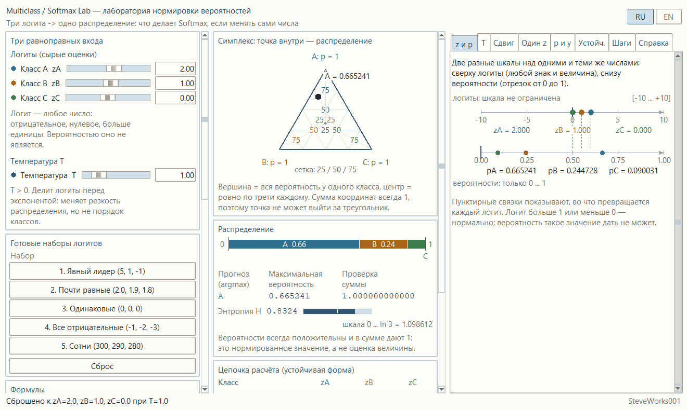
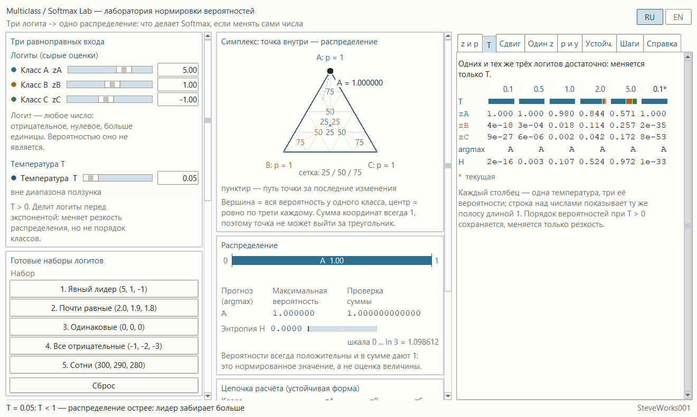
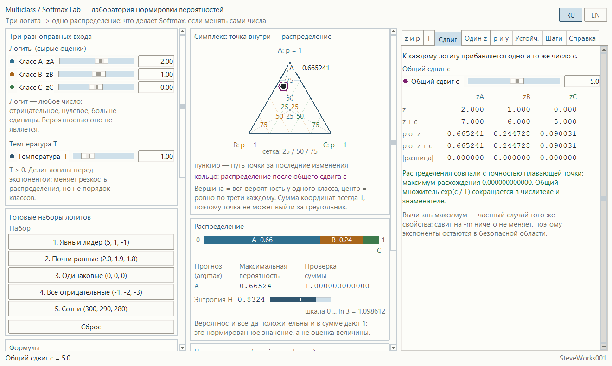
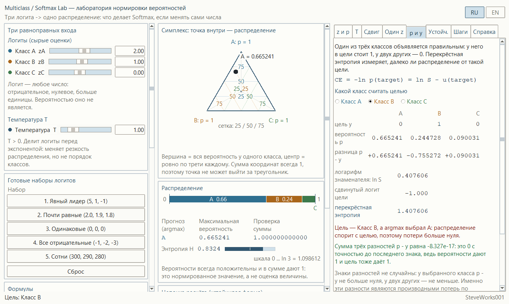
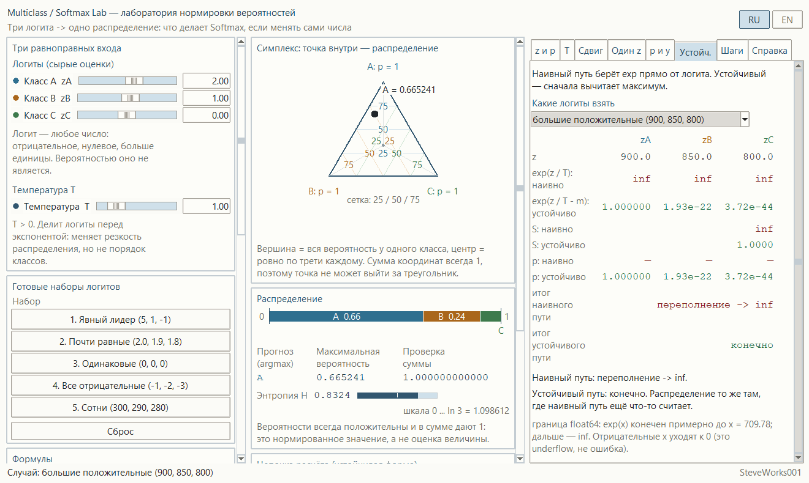

# Multiclass / Softmax Lab — учебный симулятор нормировки вероятностей

Однофайловое приложение на Python и Tkinter: только стандартная библиотека,
без внешних пакетов, без сети и без установки зависимостей.
Показывает на живом эксперименте одну цепочку: **три логита → деление на
температуру → вычитание максимума → экспоненты → знаменатель → три
вероятности → предсказание**. Это не библиотека машинного обучения и не
классификатор, который чему-то учится.

[English version](README_EN.md)

---

## Назначение

Симулятор отвечает на один вопрос: **что именно делает Softmax с числами,
которые в него положили**. На входе — три равноправных логита класса A, класса B
и класса C. Их можно менять прямо в полях и ползунках, без весов, без признаков
и без обучения. На выходе — три вероятности, которые всегда положительны и всегда
дают в сумме единицу, и предсказание как аргмакс этого распределения.

Основная цепочка, на которой построен весь интерфейс:

**z → z / T → m → u = z / T − m → exp(u) → S → p → pred**

Один и тот же расчёт виден одновременно в четырёх формах: точка в симплексе,
полоса-стопка длиной ровно 1, таблица промежуточных величин и две шкалы —
логитов и вероятностей — над одними и теми же числами. Никаких декоративных
линий и никаких заранее заготовленных выводов: все числа считаются из текущих
логитов и текущей температуры, а наивный и устойчивый пути идут из одного и
того же состояния.

### Чего в этом проекте нет

Предыдущие проекты серии учат классификации и обучению. Здесь ни того, ни
другого нет намеренно:

- нет весов, смещений, признаков и матрицы коэффициентов: логиты задаются
  руками, и это единственный вход;
- нет обучения, градиентов, эпох и обратного распространения — Softmax здесь
  стоит как готовая функция нормировки, а не как часть обучаемой модели;
  перекрёстная энтропия показана как число одной выбранной цели, и по нему
  ничего не пересчитывается;
- нет датасетов, размаркированных примеров, CSV и загрузки данных;
- нет двухмерной плоскости признаков, разделяющей границы и карты ошибок:
  задача трёхклассовая и плоскость здесь только у самого симплекса;
- нет бинарной классификации, ROC, точности, полноты и прочих метрик качества;
- нет калибровки вероятностей: приложение показывает арифметику и геометрию
  нормированного распределения и нигде не утверждает, что вероятности
  соответствуют реальной частоте событий;
- нет порогов принятия решения, cost-sensitive вывода и многомерных выходов
  больше трёх классов;
- нет внешних библиотек: ни NumPy, ни SciPy, ни matplotlib.

Всё внимание — одному центральному факту: Softmax не измеряет величину оценки,
он превращает три числа в три доли, и это превращение можно разглядеть по
шагам.

## Учебные цели

- Понять разницу между логитом и вероятностью: логит — любое число любого знака
  и любой величины, вероятность — доля на отрезке от 0 до 1.
- Пройти цепочку нормировки целиком и увидеть каждую промежуточную величину
  собственными числами.
- Понять, почему наибольший логит всегда даёт наибольшую вероятность и почему
  это единственное, что гарантирует порядок.
- Понять, откуда берётся единица в сумме: общий знаменатель делит каждую
  экспоненту на сумму всех трёх.
- Увидеть, что Softmax связан: подвинув один логит, изменяешь все три
  вероятности сразу, потому что знаменатель общий.
- Понять, зачем вычитать максимум: экспонента от неположительного числа не
  может переполнить float64, а распределение от этого не меняется.
- Сравнить наивный и устойчивый пути на одних и тех же логитах и увидеть, где
  первый даёт переполнение, а второй — конечный ответ.
- Проверить числами, что общий сдвиг всех логитов на одно и то же число ничего
  не меняет, и познакомиться с остаточным расхождением плавающей точки.
- Понять, что делает температура: она делит логиты перед экспонентой, поэтому
  меняет резкость распределения, но не порядок классов.
- Увидеть предел нормировки: при малой T распределение уходит в один класс, при
  большой — к равновероятному, но никогда не к «всем нулям» и не к «всем по
  единице».
- Научиться читать симплекс: вершина — это вся вероятность у одного класса,
  центр — ровно по трети каждому, и точка не может выйти за треугольник.
- Понять, почему полоса длиной ровно 1 — это то же самое распределение, только
  в другой форме.
- Получить интуитивное представление об энтропии как о рассеянности
  распределения, от 0 до ln 3.
- Понять, что такое перекрёстная энтропия одной цели: маловероятной цели
  соответствует большое число, уверенной и совпавшей — близкое к нулю, и
  считается оно из уже посчитанной цепочки нормировки.
- Понять, что такое ничья в аргмаксе и почему для неё нужно одно, заранее
  объявленное правило.

## Математика: три логита и одна цепочка

### Цепочка

Для логитов `zA, zB, zC` и температуры `T > 0`:

```
zK / T          масштабирование температурой
m  = max(z/T)   самый большой из масштабированных
uK = zK / T - m сдвиг, после которого максимум равен нулю
eK = exp(uK)    экспоненты: все они не больше 1 и не меньше 0
S  = eA + eB + eC
pK = eK / S     распределение: сумма ровно 1
pred = argmax(pA, pB, pC)
```

Карточка «Цепочка расчёта (устойчивая форма)» содержит восемь строк, а не
семь. Пять строк идут по классам: `z`, `z / T`, `u = z/T - m`, `exp(u)` и `p`.
Три строки — общие скаляры на всю таблицу: «максимум m», «знаменатель S» и
`pred`; у них одно значение на все три класса, и оно растянуто на все три
колонки. Шагов при этом семь: `z / T` и `m` относятся к одному, второму шагу.
При `T = 1` столбец `z / T` совпадает со столбцом `z`, и это видно в интерфейсе,
а не заявлено на словах. Строки, чей шаг новее текущего, остаются с прочерком
«—» и приглушённым стилем.

### Устойчивая форма

Рабочий путь приложения — всегда устойчивый:

```
pK = exp(zK / T - m) / (exp(zA / T - m) + exp(zB / T - m) + exp(zC / T - m))
```

Вычитание максимум — это частный случай общего сдвига, а общий сдвиг
распределения не меняет. Зато после сдвига экспонента берётся от числа не
больше нуля, поэтому переполнения не бывает ни при каких логитах, которые
принимает приложение. Знаменатель собирается через `math.fsum`, чтобы не
терять разряды на числах сильно разного размера.

### Наивный путь и где он ломается

Вкладка «Устойч.» считает то же распределение вторым способом — прямо из
`exp(z / T)`, без вычитания максимума, — и сравнивает результаты строка за
строкой. Граница честная: в float64 `exp(x)` конечен примерно до
`x = 709.78`, дальше это `inf`. Приложение знает об этом и не падает: наивный
путь возвращает статус — «конечно», «переполнение -> inf», «слишком мало -> 0»
или «0 / 0, результата нет» — и продолжает жить. Случай берётся из списка
«Какие логиты взять»: «текущие логиты», «большие положительные (900, 850,
800)», «большие отрицательные (-900, -950, -1000)» и «смешанные (710, 0,
-710)». Выбор случая поля логитов не трогает: две колонки считаются со своих
чисел, а всё остальное приложение остаётся на текущих. Если наивный путь не
конечен, его строка `p: наивно` показывает прочерки вместо вероятностей.

### Температура

```
pK = exp(zK / T) / (exp(zA / T) + exp(zB / T) + exp(zC / T))
```

`T` делит логиты перед экспонентой. `T = 1` ничего не меняет, `0 < T < 1`
усиливает разницу между логитами, `T > 1` её сглаживает. При положительной `T`
порядок классов не меняется ни при какой температуре — на этом держится и
подпись под полем «Температура», и вкладка «T». Строгая положительность
`T` — обязательное правило, а не совет: при `T = 0` деления не существует, а
при `T < 0` порядок классов переворачивается, хотя числа на вид остаются
правдоподобным распределением. Проверка стоит на пути подтверждения поля:
после ввода `0`, `-1` или `-0,5` поле краснеет и в нём остаётся прежняя
температура, строка состояния сообщает, что нужна температура строго больше
нуля, и числа на экране не пересчитываются. В математике то же правило
записано явно: `z / T` при `T <= 0` даёт `ValueError`, а не
`ZeroDivisionError`. Новой границы сверху правило не вводит: `T = 0.05` и
`T = 200` принимаются ровно как раньше.
На вкладке «T» одни и те же логиты считаются при `T = 0.1, 0.5, 1.0, 2.0, 5.0`
и ставятся в пять колонок рядом; шестая колонка появляется только тогда, когда
текущее `T` не совпадает ни с одной из пяти, и помечена звёздочкой — иначе
звёздочка встаёт над готовой колонкой. Над числами в каждой колонке — та же
полоса длиной ровно 1, под числами — argmax и энтропия.

### Общий сдвиг

```
Softmax(zA + c, zB + c, zC + c) = Softmax(zA, zB, zC)
```

Вкладка «Сдвиг» прибавляет одно и то же число `c` ко всем трём логитам и
показывает два распределения рядом — строки `p от z` и `p от z + c` — с
покомпонентной разницей в `|разница|`. Совпадение проверяется не «на глаз», а
числом: расхождение ниже `1e-12` считается совпадением с точностью float64.
Остаток в последние разряды при этом возможен, но не обязателен. На логитах по
умолчанию и на наборе «1. Явный лидер (5, 1, -1)» при `c = 60` разница равна
нулю ровно: `0.000000000000`. На наборе «2. Почти равные (2.0, 1.9, 1.8)» те же
`c = 60` оставляют остаток — `5.551e-16` при `T = 1` и `9.395e-15` при
`T = 0.1`.

### Один логит

Вкладка «Один z» меняет ровно один логит на величину `[-8 ... +8]`; класс
выбирается переключателем «Какой логит двигать» — «Класс A», «Класс B»,
«Класс C». Таблица показывает столбцы `p до`, `p после` и `сдвиг` по каждому
классу, а три кривые под ней — как все три вероятности зависят от этой дельты.
Видно главное: когда одна вероятность растёт, две другие падают, потому что
сумма равна единице всегда.

### Энтропия

```
H = -(pA ln pA + pB ln pB + pC ln pC),   0 <= H <= ln 3
```

Энтропия показана ровно одним числом и одной короткой полосой: `H = 0` — вся
вероятность у одного класса, `H = ln 3 ≈ 1.098612` — распределение ровное.
Нулевая вероятность даёт вклад 0, логарифм от нуля не берётся.

### Перекрёстная энтропия

Цель `y` — вектор из трёх чисел: 1 у выбранного класса и 0 у двух других.
Потери этой цели:

```
CE = -ln p(target) = ln S - u(target)
```

Рабочей остаётся правая запись: `ln S` и `u(target)` берутся из цепочки до
деления, поэтому число конечное даже тогда, когда вероятность класса равна нулю
в `float64` и на экране стоит `0.000000`. Левая запись объясняет смысл, а не
путь вычисления: логарифм от показанной вероятности брался бы от нуля.

Порядок здесь такой же, как у вероятностей: чем меньше `p(target)`, тем больше
`CE`; число неотрицательное, и нуль означал бы, что цель получила всю
вероятность. Как и распределение, `CE` не меняется от общего сдвига логитов:
`ln S` и `u(target)` сдвигаются на одно и то же число и в разности
сокращаются.

Разности `pK - yK` — то, что остаётся от нормировки при сравнении с целью: у
выбранного класса они неположительные, у двух других — неотрицательные, а в
сумме дают ноль с точностью до последнего знака. Именно эти разности являются
производными потерь по масштабированным логитам `uK = zK / T`, а по самим
логитам `zK` — те же разности, делённые на `T`. Приложение это соотношение
только подписывает: ни градиентов, ни обновления весов, ни спуска по этой
величине в нём нет.

### Argmax и ничья

Предсказание — номер максимального значения. При точной ничьей выигрывает
меньший индекс, то есть порядок `A → B → C`; правило подписано в интерфейсе, а
сам случай помечается звёздочкой в таблице цепочки.

## Симплекс: основная картинка

Главная визуализация — равносторонний треугольник, где вершина A означает
`pA = 1`, вершина B — `pB = 1`, вершина C — `pC = 1`. Точка внутри — это
распределение: её положение строится по барицентрическим координатам, то есть
непосредственно по трём вероятностям. Сетка проведена на уровнях 25, 50 и 75
процентов для каждого класса.

Из этой геометрии следуют три вещи, которые в приложении не нужно проверять
словами:

- точка не может выйти за треугольник, потому что все три вероятности
  положительны и в сумме дают 1;
- у грани, противоположной вершине, соответствующая вероятность равна нулю;
- центр треугольника — это ровно по трети каждому классу, то есть самое
  рассеянное распределение.

Текущая точка рисуется жирной точкой, путь за последние изменения — пунктиром:
не больше 18 последних положений, и только те перерисовки, где вероятности
реально сдвинулись. Кольцо показывает распределение, к которому привёл бы
текущий опыт, и появляется оно не всегда: только на открытой вкладке «Сдвиг»
при `c ≠ 0` и на открытой вкладке «Один z» при ненулевой дельте. Строка легенды
под треугольником показывается в те же моменты: «кольцо: распределение после
общего сдвига c» либо «кольцо: распределение после дельты». На остальных
вкладках кольца нет. Под симплексом — компактная полоса-стопка: та же самая
тройка вероятностей, нарезанная из отрезка длиной ровно 1.

## Готовые наборы логитов

Пять наборов, все детерминированные:

1. **Явный лидер (5, 1, -1)** — большое расстояние между классами, распределение
   уверенное, энтропия низкая.
2. **Почти равные (2.0, 1.9, 1.8)** — логиты рядом, вероятности близки,
   предсказание держится на десятых долях.
3. **Одинаковые (0, 0, 0)** — точная ничья: все по трети, работает правило
   `A → B → C`, энтропия максимальна.
4. **Все отрицательные (-1, -2, -3)** — отрицательные логиты не означают
   отрицательных вероятностей: распределение остаётся нормированным.
5. **Сотни (300, 290, 280)** — устойчивый путь даёт ровно то же распределение,
   что и на `(10, 0, -10)`: наборы различаются общим сдвигом на `290`, и
   разница по всем трём вероятностям равна нулю ровно. Наивный путь здесь ещё
   жив: наибольшая экспонента — около `1.94e+130`, она конечна, обе строки `p`
   показывают `0.999955`, `4.54e-05`, `2.06e-09`, а итог наивного пути —
   «конечно». Переполнение начинается позже — на «большие положительные
   (900, 850, 800)» из списка случаев.

## Интерфейс и как пользоваться

### Левая колонка

Три поля логитов в карточке «Логиты (сырые оценки)»: ползунок отвечает за
диапазон `-12 ... +12`, но в поле можно ввести любое число. Ограничивается
только модуль больше `100000` — тогда значение встаёт на эту границу и об этом
говорит строка состояния. Если число внутри `100000`, но вне ползунка, поле
остаётся с ним, ползунок показывает границу, а под полем появляется подпись
«вне диапазона ползунка» — это не ошибка ввода, а обычная ситуация: логиты
бывают и сотнями. Ниже — поле «Температура» с ползунком `0.1 ... 5.0`, где
значение обязано быть строго больше нуля, пять
готовых наборов в карточке «Готовые наборы логитов», кнопка «Сброс» и карточка
«Формулы» с шестью записями: стандартной, устойчивой, температурной, формулой
общего сдвига, аргмакса и энтропии.

### Центр

Симплекс с сеткой, точкой, путём и кольцом; под ним полоса-стопка и три
показателя карточки «Распределение» — «Прогноз (argmax)», «Максимальная
вероятность» и «Проверка суммы» с суммой до двенадцатого знака. При точной
ничьей строкой ниже появляется подпись с правилом ничьей. Ещё одной карточкой
идёт энтропия с полосой и шкалой `0 ... ln 3`. Последняя — «Цепочка расчёта
(устойчивая форма)»: восемь строк под заголовком «Класс», пять по классам
(`z`, `z / T`, `u = z/T - m`, `exp(u)`, `p`) и три общих скаляра («максимум m»,
«знаменатель S», `pred`), с подсветкой текущего шага, прочерками у нераскрытых
строк и звёздочкой при ничьей.

### Правая колонка: восемь вкладок

- **«z и p»** — две шкалы над одними и теми же числами: сверху логиты, симметричные
  и ничем не ограниченные, снизу вероятности на отрезке `0 ... 1`. Пунктирные
  связи показывают, во что превратился каждый логит; совпадения по горизонтали
  нет по построению.
- **«T»** — одни и те же логиты при пяти фиксированных температурах и при
  текущей: шестая колонка нужна только тогда, когда текущее `T` не совпадает ни
  с одной из фиксированных, иначе звёздочка встаёт над готовой колонкой.
- **«Сдвиг»** — общий сдвиг `c` в диапазоне `-60 ... +60` и таблица с
  покомпонентной разницей двух распределений; под ней — вывод числом, например
  «Распределения совпали с точностью плавающей точки: максимум расхождения
  0.000000000000».
- **«Один z»** — переключатель «Какой логит двигать», дельта `-8 ... +8`,
  таблица `p до` / `p после` / `сдвиг` и три кривые вероятности от дельты.
- **«p и y»** — цель выбирается переключателем «Какой класс считать целью», её
  вектор `y`, текущие вероятности
  `p`, разности `p - y` и число перекрёстной энтропии этой цели: `ln S`,
  сдвинутый логит цели и их разность. Отдельно подписано, совпала ли цель с
  аргмаксом. Выбор цели меняет цель, разности и потери, но не вероятности и не
  прогноз.
- **«Устойч.»** — девять строк бок о бок: `z`, `exp(z / T): наивно`,
  `exp(z / T - m): устойчиво`, `S: наивно`, `S: устойчиво`, `p: наивно`,
  `p: устойчиво`, `итог наивного пути` и `итог устойчивого пути`; плюс граница
  float64 и список «Какие логиты взять».
- **«Шаги»** — семь шагов цепочки и строка чипов `логиты -> максимум ->
  сдвиг z-m -> экспоненты -> знаменатель -> вероятности -> argmax`: текущий чип
  подсвечен, будущие приглушены. Кнопки — «Далее», «Назад» и «Сбросить»; те же
  действия делают стрелки влево и вправо, пока фокус не стоит в поле ввода, в
  раскрывающемся списке или на самой вкладке. На первом шаге «Назад» неактивна,
  на последнем неактивны «Далее» и «Сбросить»: начальное состояние шагов — это
  последний шаг.
- **«Справка»** — шестнадцать коротких тем: от «что такое логит» до «чем этот
  проект не является».

### Поля и пределы

| Вход | Диапазон ползунка | Что принимает поле |
| --- | --- | --- |
| `zA`, `zB`, `zC` | `-12 ... +12` | любое число; только при `|z| > 100000` значение ограничивается этим пределом |
| `T` | `0.1 ... 5.0` | только число строго больше нуля; положительное число вне ползунка остаётся в поле, ползунок встаёт на границу |
| общий сдвиг `c` | `-60 ... +60` | то же правило, что у логитов |
| дельта одного логита | `-8 ... +8` | то же правило, что у логитов |

Нечисловой ввод не роняет приложение: поле возвращает прежнее значение, а об
этом сообщает строка состояния. Предел по модулю — общая проверка величины
для всех четырёх полей, и у `T` к ней добавляется одно правило: температура
обязана быть строго больше нуля, иначе ввод отклоняется тем же способом.
Подробности — в разделе «Температура».

### Язык

Кнопки RU и EN переключают интерфейс на лету: логиты, температура, сдвиг, дельта,
выбранная цель, текущая вкладка и шаг не сбрасываются, меняется только подписи.

## Снимки интерфейса

Пять кадров ниже — настоящие снимки запущенного приложения (Windows 10,
Python 3.12, клиентская область окна 1320×790 px) в русском интерфейсе.
Английские кадры тех же состояний лежат в `screenshots/en/`.

### 1. Цепочка и две шкалы: логиты `2.0, 1.0, 0.0` при `T = 1.0`

Вкладка «z и p». Точка в симплексе, полоса распределения `A 0.66 / B 0.24 / C`
с проверкой суммы `1.000000000000`, энтропия `0.8324` и две шкалы над одними и
теми же числами: логиты от −10 до +10 и вероятности только от 0 до 1.



### 2. Резкая температура: набор «1. Явный лидер (5, 1, -1)» при `T = 0.05`

Вкладка «T». `T = 0.05` лежит вне ползунка — поле честно помечает это, но
значение принимает. В таблице сравнения температур правый столбец со звёздочкой
— текущая: лидер забирает `1.000`, у двух других классов `2e-35` и `8e-53`,
энтропия `1e-33`. Строка «аргмакс» во всех столбцах остаётся `A`.



### 3. Сдвиг не меняет распределение: `c = 5.0`

Вкладка «Сдвиг». `z + c` даёт `7.000 / 6.000 / 5.000`, столбцы «p от z» и
«p от z + c» совпадают цифра в цифру, в строке |разница| — нули, и зелёный
вердикт: «Распределения совпали с точностью плавающей точки:
максимум расхождения 0.000000000000».



### 4. Перекрёстная энтропия выбранной цели: цель — класс B

Вкладка «p и y». Цель `0 / 1 / 0`, вероятности `0.665241 / 0.244728 / 0.090031`,
разности `p - y` равны `+0.665241 / -0.755272 / +0.090031`, дальше потеря
собрана по формуле `CE = ln S - u(target)`: `0.407606 - (-1.000) = 1.407606`.
Аргмакс выбрал A, поэтому потери больше нуля.



### 5. Наивный путь против устойчивого: логиты `900, 850, 800`

Вкладка «Устойч.», случай «большие положительные (900, 850, 800)». Наивный
`exp(z / T)` даёт `inf / inf / inf` и знаменатель `inf`; устойчивый путь после
вычитания максимума считает `1.000000 / 1.93e-22 / 3.72e-44` при конечном
знаменателе `1.0000`. Итог: «переполнение -> inf» против «конечно».



## Справка

Вкладка «Справка» — короткий курс из шестнадцати тем, который объясняет, как
читать все остальные экраны: природу логита, смысл экспоненты, происхождение
единицы в сумме, численную устойчивость, эффект температуры, смысл
перекрёстной энтропии, правило ничьей и границы демонстрации. Формулы приведены
там, где без них не обойтись; полный учебник в приложение не встраивается.

## Учебные опыты

Пять опытов на интерфейсе приложения. Все числа в пункте «Наблюдайте» —
прочитанные с экрана строки: они отформатированы теми же полями, что видно в
окне, и получены прогоном конкретной конфигурации. Сменив логит или температуру
внутри того же опыта, вы получите честный пересчёт.

**1. Восемь строк против семи шагов.**
Действие: на вкладке «Шаги» нажмите «Назад» шесть раз, затем вернитесь «Далее»
до шага 6.
Наблюдайте: на шаге 1 счётчик даёт «Шаг 1 из 7: Логиты», формула — `zA, zB, zC`,
кнопка «Назад» неактивна, а в карточке «Цепочка расчёта (устойчивая форма)»
живые числа только в первой строке — `2.000`, `1.000`, `0.000`; все семь
остальных строк показывают «—». На шаге 6 прочерк остаётся ровно один, в строке
`pred`, и он исчезает на шаге 7, где появляется `A`.
О чём подумать: почему у строк «максимум m», «знаменатель S» и `pred` по одному
значению на все три класса, а у `z`, `z / T`, `u = z/T - m`, `exp(u)` и `p` — по
три?

**2. Одна и та же тройка при пяти температурах.**
Действие: включите набор «1. Явный лидер (5, 1, -1)» и откройте вкладку «T».
Наблюдайте: колонки `0.1`, `0.5`, `1.0*`, `2.0`, `5.0` — шестой колонки нет,
звёздочка стоит над текущей температурой; вероятность A идёт `1.000`, `1.000`,
`0.980`, `0.844`, `0.571`, энтропия — `2e-16`, `0.003`, `0.107`, `0.524`,
`0.972`, а argmax во всех пяти колонках остаётся `A`. Если поставить `T = 0.7`,
появится шестая колонка с меткой `0.7*`.
О чём подумать: при `T = 0.1` вероятность B равна `4e-18` — это не ноль, а
сколь угодно малая положительная доля. Что именно меняется в распределении, если
порядок классов при всех пяти температурах один и тот же?

**3. Подвигайте один логит — изменятся три вероятности.**
Действие: нажмите «Сброс», на вкладке «Один z» выберите «Класс A» и поставьте
дельту `1`, затем `8`.
Наблюдайте: при дельте `1` таблица даёт `p до` = `0.665241`, `0.244728`,
`0.090031`; `p после` = `0.843795`, `0.114195`, `0.042010`; `сдвиг` =
`+0.178554`, `-0.130533`, `-0.048021`. При дельте `8` вероятность A доходит до
`0.999831`, B сжимается в `0.000123`, C — в `4.54e-05`, и кольцо на симплексе
встаёт почти в вершину A.
О чём подумать: три числа в столбце `сдвиг` дают в сумме ноль. Почему у класса
не может быть «своей» вероятности, которая растёт за чужой счёт?

**4. Где наивный путь перестаёт считать.**
Действие: оставьте логиты по умолчанию и на вкладке «Устойч.» по очереди возьмите
три готовых случая из списка «Какие логиты взять».
Наблюдайте: на «большие положительные (900, 850, 800)» строка
`exp(z / T): наивно` даёт `inf`, `inf`, `inf`, `S: наивно` — `inf`, а
`итог наивного пути` — «переполнение -> inf»; устойчивый путь показывает
`1.000000`, `1.93e-22`, `3.72e-44` и итог «конечно». На «большие отрицательные
(-900, -950, -1000)» наивные экспоненты — три `0.000000`, знаменатель `0.0000`,
итог «0 / 0, результата нет», а устойчивый путь возвращает те же три числа, что
и в первом случае. На «смешанные (710, 0, -710)» наивно — `inf`, `1.000000`,
`4.48e-309` при `S = inf`, а устойчиво — `1.000000`, `4.48e-309`, `0.000000`.
Строка `p: наивно` во всех трёх случаях заполнена прочерками.
О чём подумать: на двух первых случаях устойчивый путь даёт один и тот же набор
чисел, хотя наивный путь ломается по-разному. Что меняет вычитание максимума:
само распределение или область, в которой экспонента успевает переполниться?

**5. Большое число потерь при нулевой вероятности.**
Действие: введите в поля логитов `710`, `0`, `-710` — ползунки встанут на
границу, а поля сохранят числа — и на вкладке «p и y» по очереди выберите целью
«Класс A», «Класс B», «Класс C».
Наблюдайте: строка `вероятность p` не меняется вовсе: `1.000000`, `4.48e-309`,
`0.000000`. При цели A `перекрёстная энтропия` равна `0.000000`
(`логарифм знаменателя: ln S` — `0.000000`, `сдвинутый логит цели` — `0.000`),
при цели B — `710.000000` при том же `ln S` и `-710.000`, при цели C —
`1420.000000`, хотя вероятность C на экране равна `0.000000`. Разности
`p - y` при цели C: `+1.000000`, `+4.5e-309`, `-1.000000`.
О чём подумать: откуда берётся конечное число потерь, если логарифм от
показанной вероятности брать не от чего? И почему при цели A подпись говорит,
что цель совпала с argmax, а при двух других — что распределение спорит с
целью?

---

## Установка и запуск

Приложение не нужно ни устанавливать, ни собирать — достаточно запустить один
файл из папки проекта.

**Windows:**

```bash
python multiclass_softmax_lab.py
```

**macOS и Linux:**

```bash
python3 multiclass_softmax_lab.py
```

Быстрый старт: окно открывается на логитах `2.0, 1.0, 0.0` при `T = 1.0` — это
`p = 0.665241 / 0.244728 / 0.090031`, прогноз `A`, проверка суммы
`1.000000000000` и энтропия `0.8324`. Кнопка «Сброс» возвращает именно это
состояние. Стрелки влево и вправо двигают шаг на вкладке «Шаги», пока фокус не
стоит в поле ввода, в раскрывающемся списке или на вкладке.

## Требования

- Python 3.8 или новее; приложение проверено на Python 3.12.
- Tkinter — входит в официальные сборки Python для Windows и macOS; в некоторых
  дистрибутивах Linux ставится отдельно как пакет `python3-tk`.
- Только стандартная библиотека: `math`, `tkinter`, `tkinter.ttk`,
  `tkinter.font`.
- Не используются: NumPy, pandas, SciPy, matplotlib, scikit-learn и сторонние
  GUI-фреймворки.
- Сетевое соединение для работы приложения не требуется.

Приложение открывается крупным окном и рассчитано на типичный десктопный
дисплей: начальный размер — `1320x790` пиксела, через 80 мс окно пытается
развернуться на весь экран, а там, где Tk это не разрешает, остаётся с
исходным размером. Минимальный размер — `1280×700 px`. Все три колонки лежат
в прокручиваемых областях: левая и центральная прокручиваются сами, правая —
внутри каждой вкладки, поэтому на невысоком экране любая нижняя карточка
доступна колесом мыши, а не обрезается.

## Ограничения

- Классов ровно три, и это не настраивается: симплекс в этой форме —
  двухмерный, и при другом числе классов картинка была бы другой задачей.
- Логиты принимаются по модулю до `100000`; это предел ввода, а не предел
  математики, и он выбран так, чтобы приложение оставалось отзывчивым.
- Нижняя граница `T = 0.1` стоит у ползунка, а не у расчёта: предельный случай
  `T → 0` — это уже не Softmax, а argmax, и отдельного режима для него нет.
  Требование `T > 0` при этом обязательное: `T = 0` и отрицательная `T` полем
  не принимаются, значение остаётся прежним, а в расчёте это `ValueError`
  вместо `ZeroDivisionError`.
- Энтропия показана одним числом: ни перплексии, ни сравнения энтропий между
  состояниями, ни статистики по многим повторам.
- Перекрёстная энтропия — это одно число одной выбранной цели при одном текущем
  состоянии: ни среднего по классам, ни суммы по нескольким примерам, ни
  минимизации этой величины. Цель выбирается руками и не меняет ни
  вероятности, ни прогноз.
- Проверка совпадения распределений после общего сдвига идёт по порогу `1e-12`
  и опирается на арифметику float64: остаточное расхождение в последние разряды
  возможно и не является ошибкой расчёта, но оно и не обязательно — на многих
  наборах разница равна нулю ровно.
- Наивный путь на больших логитах возвращает статус вместо числа. Он не
  пытается «спасти» вычисление: ни масштабирования, ни работы с логарифмами, ни
  произвольной точности.
- Сетка симплекса ограничена уровнями 25, 50 и 75 процентов; произвольный
  уровень провести нельзя.
- Пунктирный путь точки хранит не больше 18 последних положений и только те,
  где вероятности действительно сдвинулись, — это след истории, а не журнал.
- Вывод о предсказании — это аргмакс конкретного распределения при конкретных
  числах. Никакой проверки, правильно ли выбран класс и откалиброваны ли
  вероятности, в приложении нет и быть не должно: это граница демонстрации, и
  она подписана в справке.

## Учебная оговорка

Симулятор предназначен для того, чтобы увидеть и запомнить связь «три сырые
оценки — одно нормированное распределение — одно предсказание». Часть соглашений
выбрана ради наглядности и может отличаться от принятых в конкретной библиотеке
машинного обучения: например, три класса вместо произвольного числа, фиксированный
набор температур для сравнения, границы диапазонов ввода, порог `1e-12` для
совпадения распределений, правило ничьей `A → B → C` и перекрёстная энтропия
одной цели вместо среднего по всем классам. Переносить эти соглашения
в реальную модель нужно осознанно: там число классов задаёт задача, калибровка
вероятностей — отдельная работа, предсказание по аргмаксу не говорит ничего о
том, насколько ему можно доверять, а число потерь там — часть цикла обучения:
его усредняют по примерам и минимизируют, а не просто читают.

## Что нужно знать заранее

**Строго необходимо:** Python 3 с Tkinter и запуск одного файла из командной
строки. Ни `pip`-пакетов, ни сети, ни внешних данных, ни файлов настроек не
нужно.

**Математика:** нужно понимать, что `exp(x)` положительна при любом `x` и что
`ln x` существует только для положительных `x`; полезно знать, что `exp` растёт
быстрее любой линейной функции, — иначе числа вида `1.94e+130` и `4.48e-309`
выглядят странно. Считать руками не придётся: восемь строк цепочки приложение
вычисляет само. Главная мысль одна: все три экспоненты положительны, каждая
делится на сумму всех трёх, поэтому доли и дают в сумме единицу. Производные,
интегралы, матрицы и теория вероятностей не нужны: распределение здесь — это
три доли, а не случайная величина с событиями.

**Полезно, но не обязательно:** проект 1 «Один искусственный нейрон» — там одно
число `z` выходит из весов и входов; здесь три готовых числа подаются как есть и
становятся логитами. Проект 8 «Loss Functions» — там BCE берёт `-ln` от одного
бинарного ответа; здесь та же операция взята для одного из трёх классов и
считается как `ln S - u(target)`. Ни один проект серии не нужно проходить
заранее, чтобы открыть это приложение.

**О версии Python:** раздел «Требования» называет Python 3.8 или новее;
приложение версию не проверяет, и запуск на других версиях не тестировался —
это объявленная совместимость, а не проверенная гарантия.

---

## Место в серии

Проект 13 из 13. Порядок не строгий: каждый проект запускается сам по себе и
ничего не читает из соседних. Ниже только те связи, которые есть по содержанию.

| Проект | Связь по содержанию |
|---|---|
| 1 — Один искусственный нейрон | там одно число `z = w₁x₁ + w₂x₂ + b` считается из весов и входов; здесь три готовых числа берут как данность и нормируют |
| 5 — Backpropagation | там разность `p - y` идёт в цепное правило и двигает веса; здесь те же разности только подписаны: ни градиента, ни обновления |
| 7 — Activation Functions | там шесть активаций одного числа и Softmax среди них нет; здесь Softmax — единственный предмет, и она работает сразу с тремя |
| 8 — Loss Functions | там BCE определена на бинарной цели; здесь перекрёстная энтропия одного из трёх классов, посчитанная из уже готового знаменателя |
| 9 — Classification | там два класса, порог 0.5 и метрики по размеченному набору; здесь три класса, ни порога, ни набора |
| 12 — CNN Convolution Lab | там свёртка даёт карту признаков; здесь логиты — то, что стоит после такой карты в настоящем классификаторе |

---

## Разработчик

**Разработчик: SteveWorks001**

Приложение распространяется под лицензией MIT; полный текст — в файле
[LICENSE](LICENSE).
